# A notation for tables

*A convention for describing tables, on the `tabledesign` branch. Now in
the planner: the walk (`shape="walk"`), ovals and polygons (in Layout ▾),
and composed tables, added from table design files (Layout ▾ → Table design;
the planner comes with the T and the E below). Not yet: `box` and `seated`
for rectangles, `seated` for polygons, and the ring and stadium as shapes
of their own (each can be written as a walk).*

## The principle

For planning, a table is **where its seats are**: how many, in what order,
who sits next to whom. The plan does not have to be the hired furniture to
the centimetre, only close enough to plan with. So:

- Tables are measured in **seat units**: the length of table edge one guest
  needs, 60 cm on the plan. Every length is in seat units, along the table
  and across it.
- A table is described by **a walk round its edge**, like a waiter going
  round serving each place: so far along, a turn, so far along. Each stretch
  of the walk says how many seats it has, if any. **The order of the walk is
  the order of the seats.**
- Most tables are not written as walks but as **shapes** (a rectangle, a
  round, a hexagon) or **composed** from the venue's own tables pushed
  together. Either way, the planner turns them into a walk, and everything
  else (drawing, counting, numbering, seating) works from the walk.
- Sizes are **gross**: the seats an edge can hold, each stretch rounded down
  (there are no half guests). Anything else that takes a seat away (a
  pillar, a doorway, a wheelchair space) is done as now, by **disabling**
  that seat. The table keeps its walk and its seat numbers.

Every table can be moved and turned, as tables are now: `x` and `y`, in
centimetres on the plan, are the centre of the box round its outline, and
`rotation`, in degrees, turns it clockwise about that centre. The tables
here are described, and sketched, unturned; a horseshoe turned 90 has its
top table along the right-hand side, its arms reaching left. Turning a table
does not renumber its seats. `firstseat`, `disabled` and `open` (open-access
seats) name seats by their numbers, as now.

The sketches are all drawn by `table-notation/sketches.py`, which turns
each example into its walk and draws and counts it from the walk alone: a
first test that the rules add up.

## The walk

```xml
<table shape="walk" x="600" y="200" rotation="0">
  <step length="20" seats="20"/>
  <turn by="90"/>
  <step length="2"/>
  <turn by="90"/>
  <step length="20"/>
  <turn by="90"/>
  <step length="2"/>
</table>
```

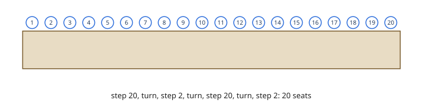

- The walk starts heading right (as the table is drawn, unturned) and goes
  **clockwise**: the table on the right, the seats on the left.
- `<step length="20" seats="20"/>` goes straight on 20 seat units, with 20
  seats spread evenly along it. `seats` is 0 if left out (a bare stretch);
  `length` is the same as `seats` if left out. A step can hold fewer seats
  than its length (`length="3" seats="2"`), never more.
- `<turn by="90"/>` turns on the spot, in degrees clockwise; a negative turn
  is anticlockwise (an inside corner, as in a T or a horseshoe).
- `<arc by="180" radius="2" seats="6"/>` bends clockwise as it goes, about
  a centre `radius` units to the right. Its length is the radius × the turn
  in radians (here 2 × π, 6.28), and it holds as many seats as that, rounded
  down. If `radius` is left out, the arc is as long as its seats.
- The walk must **come back to where it started**; the planner refuses one
  that does not, saying how far out it ends. The last turn, back to the
  starting direction, can be left out.
- The walk encloses the table, which is **filled**: a round table for 10 is
  one walk, and its middle is table.
- The planner warns of two seats so close that their chairs would collide
  (at an inside corner, say), rather than quietly moving or dropping one.

### Holes

A table with a hole in the middle (a ring, a hollow square) has **a walk
for the hole** as well: `<hole at="x y">`, starting at that point (in seat
units from the start of the main walk) heading right, and also walking
clockwise. Round a hole the table is on the left, so its seats are on the
right, facing into the hole. The hole is left unfilled, whether anyone sits
in it or not: it is there to show the room as it will be.

```xml
<table shape="walk">
  <arc by="360" radius="3.18" seats="20"/>
  <hole at="0 1.68">
    <arc by="360" radius="1.5"/>
  </hole>
</table>
```

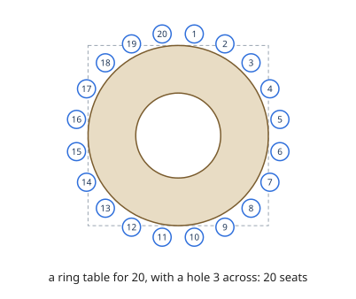

Seats are numbered round the main walk first, then round each hole.

## Shapes

One element for the common tables. Each is written here with the walk it
makes; the planner makes the walk, and you need never write it.

### Rectangle

*x* seats along each long side, *y* at each end, so **2x + 2y** seats, the
most any shape in an *x* × *y* box can hold. Seat 1 is at the left end of
the far side.

```xml
<table shape="rectangle" box="6 2" .../>
```

*Walk:* step 6 (6 seats) · turn 90 · step 2 (2 seats) · turn 90 · step 6
(6 seats) · turn 90 · step 2 (2 seats)

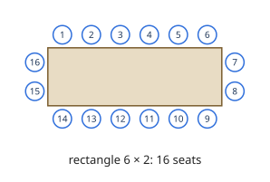

`seated` names the edges that have seats, from `far`, `near`, `left` and
`right`, or `sides` (far and near) and `ends` (left and right); the others
become bare steps. A top table, everyone facing the room:

```xml
<table shape="rectangle" box="10 1" seated="far" head="true" .../>
```

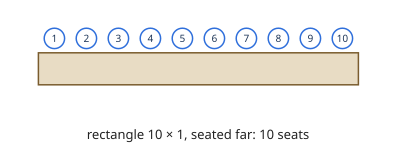

A long banqueting table, no one at the ends:

```xml
<table shape="rectangle" box="14 1" seated="sides" .../>
```


*(Today's `sideplaces="6" endplaces="2"` is the same as `box="6 2"`, and
`endplaces="0"` the same as `seated="sides"`.)*

### Round

A circle *x* across holds π*x* seats, rounded down:

```xml
<table shape="round" box="4" .../>
```

*Walk:* arc 360, radius 2 (12 seats)


*(Today's `places="10"`, the size following from the seats, stays for a
round table with an exact number of places: arc 360 with 10 seats.)*

### Stadium

Straight sides with semicircular ends: in an *x* × *y* box, two straight
steps of *x* − *y* seats, and two half-circle arcs of radius *y*/2, each
holding ⌊π*y*/2⌋. Seat 1 is at the left end of the far side.

```xml
<table shape="stadium" box="8 4" .../>
```

*Walk:* step 4 (4 seats) · arc 180, radius 2 (6 seats) · step 4 (4 seats) ·
arc 180, radius 2 (6 seats)


`seated="sides"` or `seated="ends"` leave the ends or the sides bare.

### Oval

A true ellipse cannot be walked in steps and arcs, but an oval can, as
joiners and draughtsmen make them: **four arcs** fitting the box, two flat
ones along the sides and two tight ones at the ends, each holding the seats
its length allows.

```xml
<table shape="oval" box="8 4" .../>
```

*Walk:* arc 45°, radius 8 (6 seats) · arc 135°, radius 1.5 (3 seats) · arc
45°, radius 8 (6 seats) · arc 135°, radius 1.5 (3 seats), starting where
the left end meets the far side

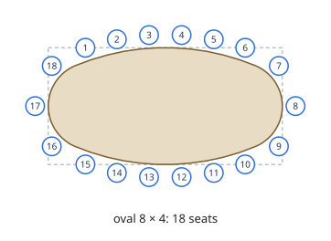

*(For the record: the end arcs' radius is the mean of b²/a and b, for half
the box's length a and half its depth b; the side arcs' radius is what
makes the four meet smoothly. A true ellipse in the same box would have
an edge of 19.4 seat units; the oval's four arcs hold 18 between them.)*

### Polygon

Given by its sides and the seats on each, *sides* × *perside* seats; each
side is *perside* units long. Side 1 is flat along the far edge, seat 1 at
its left end, and the sides are numbered clockwise.

```xml
<table shape="polygon" sides="6" perside="2" .../>
<table shape="polygon" sides="7" perside="1" .../>
```

*Walk:* (step 2 (2 seats) · turn 60) six times

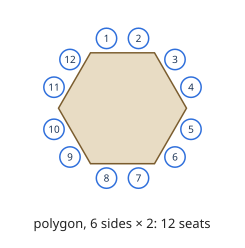


`seated` lists the sides that have seats, by number (`seated="1 2 3 5 6"`).

### A ring

A round table with a round hole, as in the walk above:

```xml
<table shape="ring" places="20" hole="3" .../>
```

## Composed tables

Venues mostly keep a stack of a few sizes of table (6 ft trestles, 4 ft
squares) and push them together, a cloth over the top. A **composed** table
says just that: which of the venue's tables go where. The planner fits them
together, finds the outline and any holes, and walks them.

```xml
<table shape="composed" name="Top table" head="true" ...>
  <tables size="2 1" count="5" at="0 0" going="right" bare="near"/>
  <tables size="1 2" count="3" at="0 1" going="down"/>
  <tables size="1 1" at="0 7" bare="near"/>
  ...
</table>
```

- `size` is each table as placed, in seat units, along and across (`2 1`
  lying left to right, `1 2` running down the page). A venue's tables in
  gross seat units: a 6 ft trestle is about 3 × 1, a 4 ft square about
  2 × 2, a 2 × 1 about 4 ft by 2 ft.
- `count` tables in a line from `at` (in seat units, from the top left of
  the composed table), each `going` right or down from the one before
  (one table, going right, if left out).
- Every unit of the outline is seated, unless its table says that side is
  **bare**: `bare` lists `far`, `near`, `left` and `right`, as the table is
  placed. A side that is pushed against another table is not on the outline
  anyway, so `bare="near"` on a row of five only bares the near sides.
- The edges round a hole are bare unless the table says `seated="holes"`.
- **An inside corner costs a seat** where both its edges are seated: the
  two chairs would want the same place, so the later one round the walk is
  left out.
- The walk starts at the top left, heading right, and goes round the
  outline clockwise, then round each hole: that is the seat numbering.
- The planner also gives the **pick list**: how many of each size of table
  the layout takes, to check against what the venue has.

### Horseshoe

A top table of five 2 × 1s, with arms of three 1 × 2s and a 1 × 1 down
each side, seated on both sides of the arms:

```xml
<table shape="composed" name="Top table" head="true" ...>
  <tables size="2 1" count="5" at="0 0" bare="near"/>
  <tables size="1 2" count="3" at="0 1" going="down"/>
  <tables size="1 1" at="0 7" bare="near"/>
  <tables size="1 2" count="3" at="9 1" going="down"/>
  <tables size="1 1" at="9 7" bare="near"/>
</table>
```

*Walk:* step 10 (10 seats) · turn 90 · step 8 (8 seats) · turn 90 · step 1 ·
turn 90 · step 7 (7 seats) · turn −90 · step 8 · turn −90 · step 7 (7 seats)
· turn 90 · step 1 · turn 90 · step 8 (8 seats)

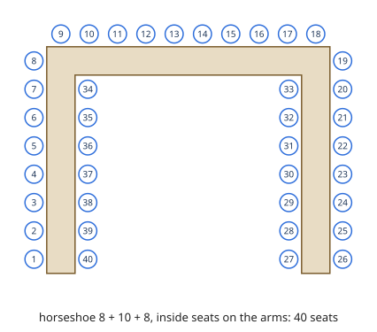

The arms' inside edges are bare in this one (`bare="right"` on the left
arm, `bare="left"` on the right):


### Hollow square

Fourteen 2 × 1s round an 8 × 8 square, the middle open:

```xml
<table shape="composed" ...>
  <tables size="2 1" count="4" at="0 0"/>
  <tables size="1 2" count="3" at="7 1" going="down"/>
  <tables size="2 1" count="4" at="0 7"/>
  <tables size="1 2" count="3" at="0 1" going="down"/>
</table>
```


With `seated="holes"`, the hole's four sides are 6 long, and each of its
four corners costs a seat: 24 − 4 = 20 more.

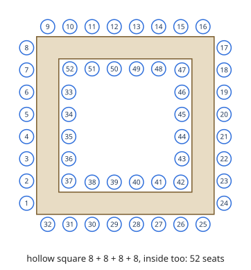

### T and E

A **T**: a top table of 11 (five 2 × 1s and a 1 × 1), a stem of four 1 × 2s
from its middle. The stem need not meet the top table at a join.

```xml
<table shape="composed" name="Top table" head="true" ...>
  <tables size="2 1" count="5" at="0 0" bare="near left"/>
  <tables size="1 1" at="10 0" bare="near right"/>
  <tables size="1 2" count="4" at="5 1" going="down" bare="near"/>
</table>
```

*Walk:* step 11 (11 seats) · turn 90 · step 1 · turn 90 · step 5 · turn −90 ·
step 8 (8 seats) · turn 90 · step 1 · turn 90 · step 8 (8 seats) · turn −90 ·
step 5 · turn 90 · step 1

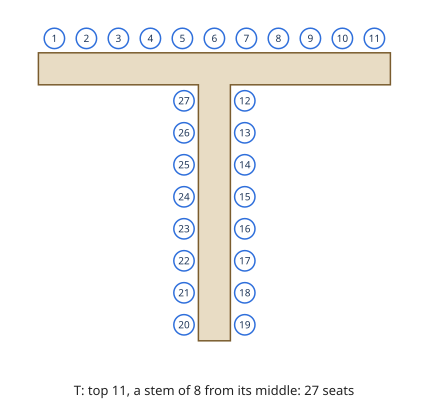

An **E** (or a top table with sprigs): a top table of 13 and three prongs
of 8, two of them flush with its ends, so their outside edges carry
straight on from the top table's ends:

```xml
<table shape="composed" name="Top table" head="true" ...>
  <tables size="2 1" count="3" at="0 0" bare="near left"/>
  <tables size="1 1" at="6 0" bare="near"/>
  <tables size="2 1" count="3" at="7 0" bare="near right"/>
  <tables size="1 2" count="4" at="0 1" going="down" bare="near"/>
  <tables size="1 2" count="4" at="6 1" going="down" bare="near"/>
  <tables size="1 2" count="4" at="12 1" going="down" bare="near"/>
</table>
```

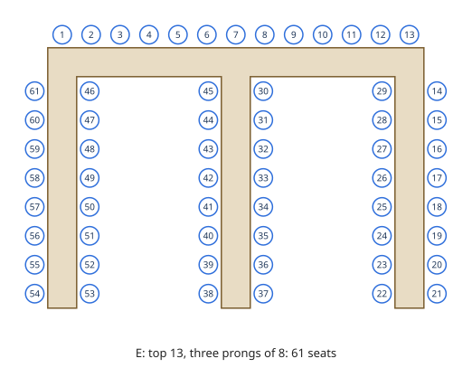

With the inside of the top table seated too (`bare` without `near` on the
top tables), each of the two gaps between prongs is 5 long with an inside
corner at each end: 3 more seats in each, and a seat fewer at the top of
the four sides that face into the gaps (61 + 10 − 4 = 67).

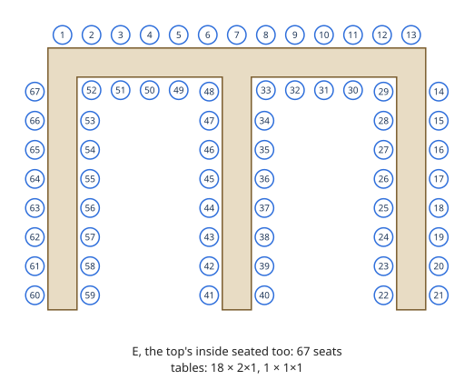

## Still to settle

- **Tables at an angle** in a composed table (a chevron, a herringbone):
  composing works on the seat-unit grid, at right angles; anything else is
  a walk, or separate tables.
- **A pick list for the whole room**, adding up every composed table, to
  check against the venue's stock in one go.
- **Named shorthands** for composed shapes (`<horseshoe top="10" arms="8"
  inside="yes"/>`), if composing them proves long-winded.
