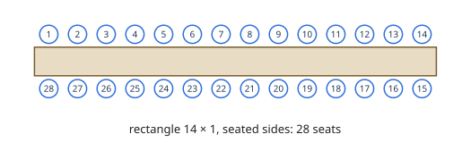
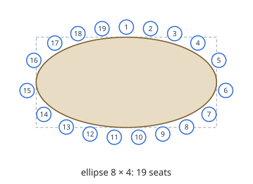
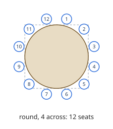
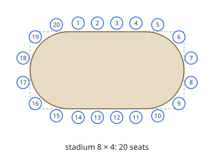
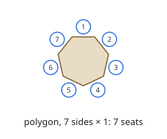
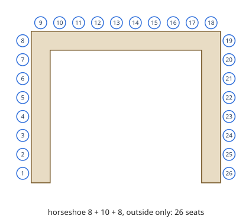
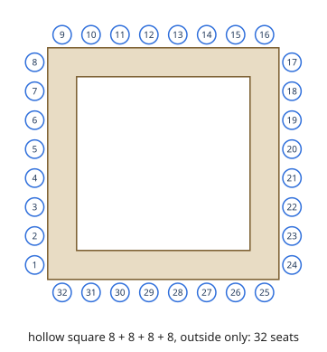

# A notation for tables

*A draft, on the `tabledesign` branch: a convention for describing tables in
a layout file, before any of it is programmed.*

## The principle

For planning, a table is **where its seats are**: how many, in what order,
who sits next to whom. The plan does not have to be the hired furniture to
the centimetre, only close enough to plan with. So:

- Tables are measured in **seat units**: the length of table edge one guest
  needs, 60 cm on the plan.
- Every shape has a **gross size**, in whole seat units: its enclosing box,
  *x* along and *y* across, or for a polygon its sides and seats per side.
- The **seats** are what the shape's edge holds, by its own geometry, each
  edge rounded down (there are no half guests). A shape can say which of its
  edges are not seated at all (the back of a top table).
- Anything else that takes a seat away (a pillar, a doorway, a wheelchair
  space) is done as now, by **disabling** that seat. The table keeps its
  gross size and seat numbers.

Every shape can be moved and turned, as tables are now: `x` and `y`, in
centimetres on the plan, are the centre of its enclosing box (for a polygon
or a joined table, the box round its outline), and `rotation`, in degrees,
turns it clockwise about that centre. The shapes are described, and
sketched here, unturned; a horseshoe turned 90 has its top table along the
right-hand side, its arms reaching left. Turning a table does not renumber its seats. Seats are counted **clockwise**
from 1, and `firstseat`, `disabled` and `open` (open-access seats) name
them by those numbers, as now.

## Simple shapes

One element, its seats all round the edge unless `seated` says otherwise.

### Rectangle

*x* seats along each long side, *y* at each end: **2x + 2y** seats, the
most any shape in an *x* × *y* box can hold. Seat 1 is at the left end of
the far side.

```xml
<table shape="rectangle" box="6 2" x="600" y="400" rotation="0"/>
```


`seated` names the edges that have seats, from `far`, `near`, `left` and
`right`, or `sides` (far and near) and `ends` (left and right). A top table,
everyone facing the room:

```xml
<table shape="rectangle" box="10 1" seated="far" head="true" .../>
```


A long banqueting table, no one at the ends:

```xml
<table shape="rectangle" box="14 1" seated="sides" .../>
```



*(Today's `sideplaces="6" endplaces="2"` is the same as `box="6 2"`, and
`endplaces="0"` the same as `seated="sides"`.)*

### Ellipse and round

The seats are spaced evenly round the edge, as many as its length holds.
For a box *x* × *y*, with *a* = *x*/2 and *b* = *y*/2, the edge is
(Ramanujan) π[3(*a*+*b*) − √((3*a*+*b*)(*a*+3*b*))], about 80% of the
rectangle's 2x + 2y. Seat 1 is at the top.

```xml
<table shape="ellipse" box="8 4" .../>
```



A round table is an ellipse in a square box, π*x* seats:

```xml
<table shape="round" box="4" .../>
```



*(Today's `places="10"`, the size following from the seats, stays for a
round table with an exact number of places.)*

### Stadium

Straight sides with semicircular ends, the shape of most hired "ovals": two
straight sides of *x* − *y* seats, and two ends of ⌊π*y*/2⌋. Seat 1 is at
the left end of the far side.

```xml
<table shape="stadium" box="8 4" .../>
```



`seated="sides"` or `seated="ends"` leave the ends or the sides bare.

### Polygon

Given by its sides and the seats on each, *sides* × *perside* seats; its
size follows (each side *perside* seat units long). Side 1 is flat along the
top, seat 1 at its left end, and the sides are numbered clockwise.

```xml
<table shape="polygon" sides="6" perside="2" .../>
<table shape="polygon" sides="7" perside="1" .../>
```




`seated` lists the sides that have seats, by number (`seated="1 2 3 5 6"`).

## Joined tables

A table made of straight pieces, each with seats of its own (a horseshoe, an
L, a hollow square), is one table, with one number, drawn as a **path**:
the runs of its outside edge, walked clockwise, each turning into the next.

```xml
<table shape="joined" depth="1" closed="no" ...>
  <run length="8" seated="outside inside"/>
  <run turn="90" length="10" seated="outside"/>
  <run turn="90" length="8" seated="outside inside"/>
</table>
```

- `length` is the run's **outside** edge, in seat units; it holds that many
  outside seats.
- Each run after the first starts with a `turn`, in degrees clockwise
  (90, a right angle, if left out; a negative turn is to the left).
- `depth` is how deep the table is, in seat units (1 if left out).
- `seated` says which edges of the run have seats: `outside`, `inside`, both,
  or neither (`seated=""`).
- The **inside** edge is shorter: a right-angled corner takes `depth` off
  each run it joins, so an arm of 8 has 7 inside seats.
- `closed="yes"` joins the last run back to the first.
- The seats are counted along the outside first, in the order of the runs,
  then back along the inside: clockwise round the table's edge.

### Horseshoe

A top table of 10, arms of 8, with guests inside the arms too:

```xml
<table shape="joined" name="Top table" head="true" x="600" y="300" rotation="0">
  <run length="8" seated="outside inside"/>     <!-- the left arm, from its foot up -->
  <run length="10" seated="outside"/>           <!-- the top table, facing down the room -->
  <run length="8" seated="outside inside"/>     <!-- the right arm, down to its foot -->
</table>
```


The same with the inside of the arms bare (`seated="outside"` on every run):



### Hollow square

```xml
<table shape="joined" closed="yes" ...>
  <run length="8" seated="outside"/>
  <run length="8" seated="outside"/>
  <run length="8" seated="outside"/>
  <run length="8" seated="outside"/>
</table>
```



### Curves

An `<arc>` is a run that bends as it goes, for a curved top table or a
stadium drawn as a path:

```xml
<arc turn="180" radius="2" seated="outside"/>
```

Its outside edge is *radius* × the turn in radians (π × 2 for this one, so 6
seats); a stadium is then two runs and two arcs, `closed="yes"`, and draws
the same as `shape="stadium"`.

## Still to settle

- **Branches.** A T, or an E (a top table with sprigs), needs a run that
  starts part-way along another. Perhaps `<run from="2" at="5" ...>`: off run
  2, after its 5th seat.
- **Named shorthands**, such as `<horseshoe top="10" arms="8" inside="yes"/>`,
  if the paths prove too long-winded for the usual shapes.
- **Seat units for the gaps**: whether a joined table's corner and an
  ellipse's spacing ever need to be other than 60 cm.

The sketches are drawn by `table-notation/sketches.py` (Python, no
libraries), which works out each table's seats by these rules: a first test
that they add up.
